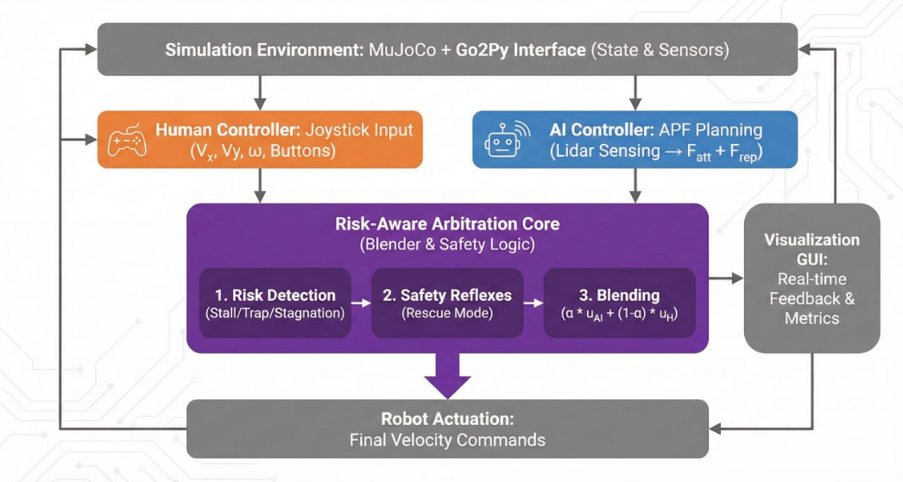

## SHARC: Shared Human–AI Robot Control Project Group

This repository contains the work of **Project Group1 ROBO 666**, focused on the design and implementation of a **Shared Human–AI Control for Robotics**.

The project explores how human joystick inputs and autonomous AI controllers can be combined through **risk-aware arbitration mechanisms**, enabling smooth authority blending and safe switching between human and AI control. The system is designed to handle challenging navigation scenarios such as narrow passages, local minima,  deadlocks, stalls, and obstacle-dense environments.

Key features of the project include:
- Shared control between human operator and AI planner  
- Blending and switching arbitration strategies using adaptive authority parameters  
- Risk detection mechanisms (stall, trap, stagnation)  
- Simulation-based validation using physics-based robotic environments  
- Visualization and logging tools for analysis and evaluation  

## System Architecture

  

The system architecture illustrates the complete shared control pipeline:
- **Simulation Environment**: MuJoCo physics engine with Go2Py interface providing state and sensor data
- **Human Controller**: Joystick input processing for manual control commands
- **AI Controller**: APF (Artificial Potential Field) planning using Lidar sensing
- **Risk-Aware Arbitration Core**: The central decision-making component that includes:
  1. Risk Detection (identifying stall, trap, and stagnation conditions)
  2. Safety Reflexes (rescue mode activation when needed)
  3. Blending Logic (combining human and AI inputs using adaptive authority parameters α)
- **Visualization GUI**: Real-time feedback and performance metrics
- **Robot Actuation**: Final velocity commands sent to the robot

## Researchers
- Pechchuma Manoharan  
- Rong Guo  
- Anastasiia Nikitina  

## Mentor
- Henry Ascencio Trejo  

This repository serves as a collaborative workspace for code, experiments, simulations, and documentation related to the ROBO 666 Shared Control Project and future research works.
